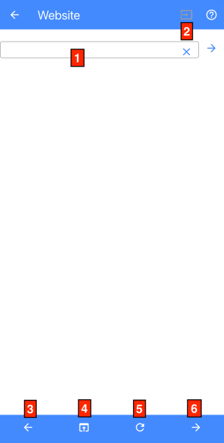

# Màn hình web

Màn hình hiển thị trang web và cung cấp công cụ nhập dữ liệu.

> Lưu ý: bản thân ứng dụng không cung cấp trang web nào. Màn hình này hiển thị các trang web công cộng của các đơn vị ngoài.



- Mục 1: Nhập hoặc chọn địa chỉ trang web. Sau đó nhấn Enter trên bàn phím hoặc nút mũi tên bên phải để tải trang web.
- Nút 2: tiện ích nhập dữ liệu. Nút này chỉ khả dụng khi đạt 2 điều kiện:
  - Trang web đã nạp xong.
  - URL trang web nằm trong cấu hình hỗ trợ.
- Nút 3, 6: di chuyển lùi / tiến giữa các trang web đã xem.
- Nút 4: mở trang web gốc trong trình duyệt mặc định của hệ thống.
> Lưu ý nếu chọn mở trang web trong trình duyệt mặc định của hệ thống (bên ngoài `Sách của T`) thì không sử dụng được chức năng nhập liệu.
- Nút 5: nạp lại trang web hiện tại.

## Chức năng nhập liệu:

- Chức năng đóng vai trò như nút Sao chép (Copy & Paste) nội dung trang web.
- Nhấn vào nút số 2 để nhập dữ liệu từ trên web vào thông tin sách:
  - Đối với trang web có nhiều kết quả: ứng dụng sẽ mở một hộp thoại danh sách để chọn.
  - Đối với trang web chỉ có 1 kết quả: `Sách của T` tự động chuyển về màn hình **Sách**.

> Lưu ý: trang web không được cung cấp bởi ứng dụng này; tiện ích sao chép dữ liệu trực tiếp từ nội dung hiển thị trên màn hình, trang web có thể thay đổi, nên chức năng này không đảm bảo thực hiện chính xác như mong đợi.

### Cấu hình chức năng nhập liệu:

- Bước 1: cấu hình danh sách trang web chứa thông tin sách để nhập. Xem hướng dẫn **Cấu hình danh sách website tìm ảnh trên Internet** ở màn hình **Sách**.
- Bước 2: Chỉnh sửa tệp mã lệnh lấy thông tin. Yêu cầu: biết sửa JSON và Javascript.
  - Lấy tệp `nhap_sach.json` từ mã nguồn.
  - Chỉnh sửa nội dung `nhap_sach.json`, là JSON có cấu trúc sau:
    - `ma_lenh`: danh sách các đối tượng chứa thông tin từng trang web. Mỗi đối tượng có cấu trúc sau:
      - `bo_regex`: danh sách các chuỗi Biểu thức chính quy (Regular Expression) để đánh giá đường dẫn trang web hiện tại, nếu đường dẫn phù hợp thì bỏ qua trang web này (không phù hợp để nhập liệu)
      - `bo_chinh_xac`: danh sách các đường dẫn bị bỏ qua (so sánh `==`)
      - `loc_chinh_xac`: danh sách các đường dẫn có thể nhập liệu (so sánh `==`)
      - `loc_regex`: danh sách các chuỗi Biểu thức chính quy (Regular Expression) để đánh giá đường dẫn trang web hiện tại, nếu đường dẫn phù hợp thì có thể nhập liệu.
      - `ma`: đoạn mã Javascript để nhập liệu. Đoạn mã mẫu như sau:
      ```
      function layDanhSachSach(){
        let ketQua = [];
        let sach = {};
        sach["ten"] = ...;
        ketQua.push(sach);
        return ketQua;
      }
      ```
      - Giải thích:
        - Đoạn mã luôn nằm trong hàm `layDanhSachSach`.
        - Kết quả trả về là 1 mảng các object. Mỗi object chứa thông tin sách. Danh sách các thuộc tính của sách xem trong mã nguồn ứng dụng (`TruongThongTinSachTuInternet` trong `man_hinh_web.dart`).
  - Sao chép tệp `nhap_sach.json` vào bên cạch tệp `websites.json`.
